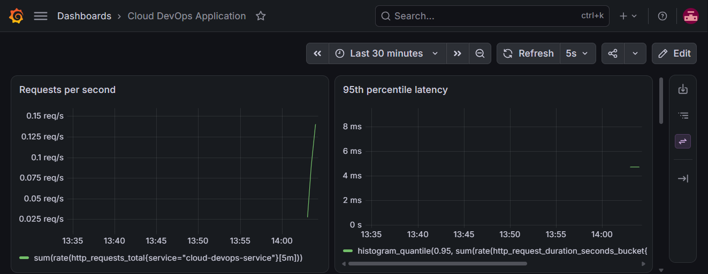
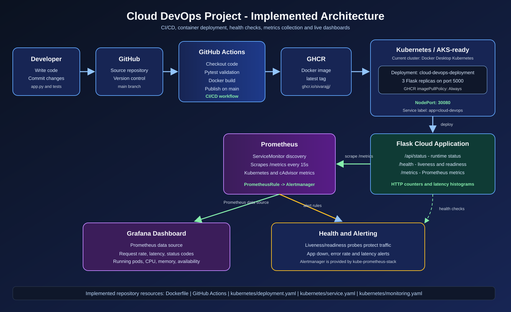

# Cloud DevOps Dashboard

A Flask-based dashboard demonstrating an end-to-end Cloud DevOps workflow:

```text
Developer -> GitHub -> GitHub Actions -> Tests -> Docker -> GHCR -> Kubernetes -> NodePort
                                                                    |
                                                                    +-> Prometheus -> Grafana -> Alerts
```

## Features

- Flask dashboard at `/`
- Application status API at `/api/status`
- Kubernetes health endpoint at `/health`
- Responsive HTML, CSS, and JavaScript frontend
- Docker containerization
- Kubernetes Deployment with three replicas
- Liveness and readiness probes
- GitHub Actions test, build, and GHCR publishing workflow
- Prometheus application metrics and alert rules
- Grafana dashboard provisioned from Kubernetes manifests with application and pod resource panels

## Technology Stack

- Python 3.13
- Flask
- Pytest
- Docker
- Kubernetes
- GitHub Actions
- GitHub Container Registry

## Prerequisites

- Git
- Python 3.13+
- Docker Desktop
- Docker Desktop Kubernetes enabled
- `kubectl`

## Run Locally

From the project directory:

```bash
python -m venv .venv
source .venv/bin/activate
pip install -r requirements.txt
python app.py
```

Open <http://localhost:5000>.

## Run Tests

Install development dependencies and run the test suite:

```bash
pip install -r requirements-dev.txt
python -m pytest -v
```

The tests cover the dashboard page, status endpoint, health endpoint, and
Prometheus metrics endpoint.

## Docker

Build and run the image locally:

```bash
docker build -t cloud-devops-app:latest .
docker run --rm -p 5001:5000 cloud-devops-app:latest
```

Open <http://localhost:5001>.

## Kubernetes Deployment

Apply the Deployment and Service from the repository root:

```bash
kubectl apply -f kubernetes/deployment.yaml
kubectl apply -f kubernetes/service.yaml
```

Verify the rollout:

```bash
kubectl rollout status deployment/cloud-devops-deployment
kubectl get deployment cloud-devops-deployment
kubectl get pods -l app=cloud-devops -o wide
kubectl get service cloud-devops-service
```

The Service exposes the application at:

```text
http://localhost:30080
```

Useful endpoint checks:

```bash
curl http://localhost:30080/health
curl http://localhost:30080/api/status
```

## Monitoring with Prometheus and Grafana

Deploy the application and monitoring stack:

```bash
kubectl apply -f kubernetes/deployment.yaml
kubectl apply -f kubernetes/service.yaml
kubectl apply -f kubernetes/monitoring.yaml
```

The application exposes Prometheus metrics at `/metrics`. The existing
kube-prometheus-stack scrapes the application Service every 15 seconds through
the ServiceMonitor and evaluates alerts for application outages, high 5xx
error rates, and high request latency.

Open the monitoring tools locally:

```text
Prometheus: http://localhost:30900
Grafana:    http://localhost:30300
```

The monitoring manifest provisions a `Cloud DevOps Application` dashboard in
the existing Grafana instance. The Grafana credentials are managed by the
Helm release's Kubernetes Secret.

The monitoring stack is currently running on Docker Desktop Kubernetes. The
same Kubernetes resources can be applied to AKS after installing the
kube-prometheus-stack and configuring the cluster's external access.

Check monitoring resources with:

```bash
kubectl get pods -n monitoring
kubectl get servicemonitor cloud-devops
kubectl get prometheusrule -n monitoring cloud-devops
kubectl port-forward -n monitoring service/monitoring-kube-prometheus-prometheus 9090:9090
kubectl port-forward -n monitoring service/monitoring-grafana 3000:80
```

The Deployment uses the public image:

```text
ghcr.io/sivarajjj/cloud-devops-project:latest
```

### Health Probes

Both probes call `/health` on port `5000`.

- **Readiness probe:** removes a pod from Service traffic while it is not ready.
- **Liveness probe:** restarts a container that remains unhealthy.

Inspect probe configuration and events with:

```bash
kubectl describe deployment cloud-devops-deployment
kubectl describe pods -l app=cloud-devops
```

## GitHub Actions and GHCR

The workflow in `.github/workflows/docker-build.yml` runs for pushes and pull requests targeting `main`. It:

1. Installs the application and test dependencies.
2. Runs `python -m pytest -v`.
3. Builds the Docker image.
4. Logs in to GHCR for pushes to `main`.
5. Publishes `ghcr.io/sivarajjj/cloud-devops-project:latest`.

The workflow uses the built-in `GITHUB_TOKEN` with package write permission.

## Monitoring Notes

Pod readiness, restart counts, probe configuration, Service endpoints,
application metrics, and application logs can be inspected with `kubectl`.
CPU and memory metrics require the Kubernetes Metrics API; if `kubectl top
pods` reports `Metrics API not available`, live resource usage is not
currently enabled in the cluster.

## Troubleshooting

### Pods are not ready

```bash
kubectl get pods -l app=cloud-devops
kubectl describe pods -l app=cloud-devops
kubectl logs -l app=cloud-devops --tail=50 --prefix
```

Confirm that the container listens on port `5000` and that `/health` returns HTTP 200.

### Service has no endpoints

```bash
kubectl get service cloud-devops-service
kubectl get endpoints cloud-devops-service
kubectl get pods --show-labels
```

The Service selector must match the pod label `app=cloud-devops`.

### GHCR image cannot be pulled

Check the image name and tag:

```bash
kubectl get deployment cloud-devops-deployment -o jsonpath="{.spec.template.spec.containers[0].image}"
```

The package must be public, or the cluster must be configured with an image pull secret.

## Screenshots

## Final Visual Deliverables

The dashboard screenshot below was captured from the deployed Grafana instance
at `http://localhost:30300` using live Prometheus data. It includes request
rate, response latency, response status codes, total requests, running pods,
CPU, memory, and availability.



The architecture diagram reflects the implemented GitHub Actions, GHCR,
Kubernetes, Flask, Prometheus, Grafana, health probe, and alerting flow. The
current deployment is Docker Desktop Kubernetes; the manifests are AKS-ready
after installing kube-prometheus-stack in the AKS cluster.




## Future Improvements

- Add resource requests and limits after enabling cluster metrics.
- Add deployment versioning and rollback automation.
- Add HTTPS through an Ingress controller.
- Add persistent storage for Prometheus and Grafana data.
